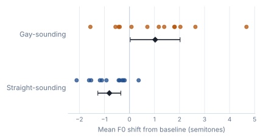
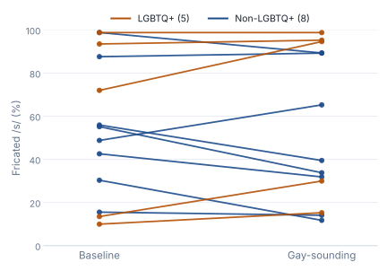

I work with speech and text data from start to finish, from collecting and cleaning recordings to building statistical and machine learning models that explain how people use language. These case studies show the question, the data, the methods, and what I found.

  <h2>Pitch and performed persona in Seville</h2>
  
Manuscript under review

  <figure class="fig">
    
    <figcaption>Each dot is one speaker’s average pitch shift from their baseline voice. Diamonds show the mean across speakers with a 95% confidence interval. 13 men from Seville.</figcaption>
  </figure>
  <dl class="toolkit">
    
<dt>Question</dt><dd>How do men change their pitch when they perform a gay-sounding or straight-sounding voice?</dd>

    
<dt>Data</dt><dd>2,431 utterances from 13 male speakers from Seville, each reading in baseline, gay-sounding, and straight-sounding personae.</dd>

    
<dt>Methods</dt><dd>F0 extraction in Praat, linear mixed-effects models with by-speaker random slopes (lme4), and generalized additive mixed models for pitch contours (mgcv).</dd>

    
<dt>Finding</dt><dd>The gay-sounding persona raised mean pitch by about 1 semitone and widened pitch range, with large differences between speakers. The straight-sounding persona lowered pitch by slightly less, and speakers largely agreed. Performing gay required moving away from baseline, and performing straight stayed close to it.</dd>

  </dl>

  <h2>Who performs which /s/ in Seville</h2>
  
Manuscript in preparation

  <figure class="fig">
    
    <figcaption>Each line is one speaker’s rate of fully pronounced (fricated) /s/ at baseline and in the gay-sounding persona. 13 men from Seville, 6,261 tokens.</figcaption>
  </figure>
  <dl class="toolkit">
    
<dt>Question</dt><dd>Do LGBTQ+ and non-LGBTQ+ men from Seville use the same sounds when they perform a gay-sounding persona?</dd>

    
<dt>Data</dt><dd>6,261 syllable-final /s/ tokens and 10,244 stressed vowel tokens from the same 13 speakers, read at baseline and in gay-sounding and straight-sounding personae.</dd>

    
<dt>Methods</dt><dd>Forced alignment with the Montreal Forced Aligner, acoustic measurement with Praat scripts, mixed-effects models with by-speaker random slopes (lme4, lmerTest), and exact permutation tests that treat the speaker as the unit of analysis. The full pipeline reproduces in R and Python.</dd>

    
<dt>Finding</dt><dd>In the gay-sounding persona, all five LGBTQ+ speakers kept or increased the fully pronounced [s], and six of the eight non-LGBTQ+ speakers reduced it (speaker-level permutation test, p = .030). The spectral quality of /s/ stayed the same, and vowels barely moved. Together with the pitch results, this suggests that some cues to a gay persona are shared across Seville, while the use of /s/ depends on who performs it.</dd>

  </dl>

  <h2>Classifying sociophonetic identity markers</h2>
  
In progress

  <dl class="toolkit">
    
<dt>Question</dt><dd>Which acoustic features best separate the personae speakers perform?</dd>

    
<dt>Methods</dt><dd>A pilot convolutional neural network trained on spectrograms (PyTorch), with random forest and support vector machine classifiers on acoustic measurements in development (scikit-learn).</dd>

  </dl>

  <h2>Retail review NLP</h2>
  
<a href="https://github.com/calebhkelley/retail-review-nlp">Code on GitHub</a>

  <dl class="toolkit">
    
<dt>Data</dt><dd>568,000 Amazon product reviews.</dd>

    
<dt>Methods</dt><dd>Sentiment analysis, LDA topic modeling, and supervised text classification in Python.</dd>

  </dl>

