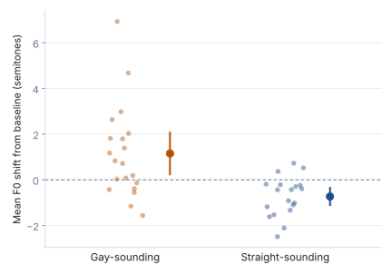
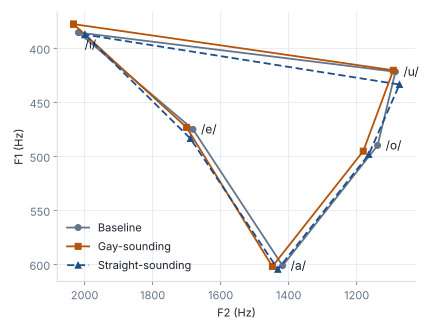

I work with speech and text data from start to finish, from collecting and cleaning recordings to building statistical and machine learning models that explain how people use language. These case studies show the question, the data, the methods, and what I found.

  <h2>Prosodic personae across three Spanish varieties</h2>
  
Manuscript under review

  <figure class="fig">
    
    <figcaption>Each dot is one speaker’s average pitch shift from their baseline voice. Bars show 95% confidence intervals.</figcaption>
  </figure>
  <dl class="toolkit">
    
<dt>Question</dt><dd>How do men change their pitch when they perform a gay-sounding or straight-sounding voice?</dd>

    
<dt>Data</dt><dd>3,846 utterances from 20 male speakers in Sevilla, País Vasco, and Venezuela, each reading in baseline, gay-sounding, and straight-sounding personae.</dd>

    
<dt>Methods</dt><dd>F0 extraction in Praat, linear mixed-effects models with by-speaker random slopes (lme4), and generalized additive mixed models for pitch contours (mgcv).</dd>

    
<dt>Finding</dt><dd>The gay-sounding persona raised mean pitch by about 1 semitone and widened pitch range, with large differences between speakers. The straight-sounding persona lowered pitch by about 0.8 semitones, and speakers largely agreed. Performing gay required moving away from baseline, and performing straight stayed close to it.</dd>

  </dl>

  <h2>Vowel space and performed identity</h2>
  
Manuscript in preparation

  <figure class="fig">
    
    <figcaption>Mean formant values for /i e a o u/ by persona, averaged across speakers.</figcaption>
  </figure>
  <dl class="toolkit">
    
<dt>Question</dt><dd>Do Sevillian men reshape their vowels when they perform different personae?</dd>

    
<dt>Data</dt><dd>About 33,000 vowel tokens from 13 male speakers from Seville.</dd>

    
<dt>Methods</dt><dd>Forced alignment with the Montreal Forced Aligner, formant extraction with Praat scripts, and mixed-effects modeling in R.</dd>

    
<dt>Finding</dt><dd>Most speakers fronted their vowels (raised F2) in the gay-sounding persona, by about 40 Hz on average.</dd>

  </dl>

  <h2>Classifying sociophonetic identity markers</h2>
  
In progress

  <dl class="toolkit">
    
<dt>Question</dt><dd>Which acoustic features best separate the personae speakers perform?</dd>

    
<dt>Methods</dt><dd>Random forest and support vector machine classifiers on acoustic measurements, and a convolutional neural network trained on spectrograms (Python, scikit-learn, PyTorch).</dd>

  </dl>

  <h2>Retail review NLP</h2>
  
<a href="https://github.com/calebhkelley/retail-review-nlp">Code on GitHub</a>

  <dl class="toolkit">
    
<dt>Data</dt><dd>568,000 Amazon product reviews.</dd>

    
<dt>Methods</dt><dd>Sentiment analysis, LDA topic modeling, and supervised text classification in Python.</dd>

  </dl>

